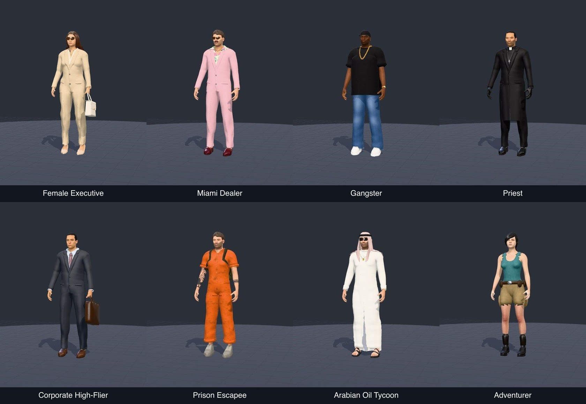
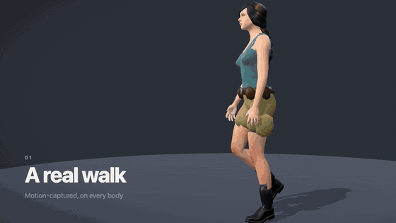
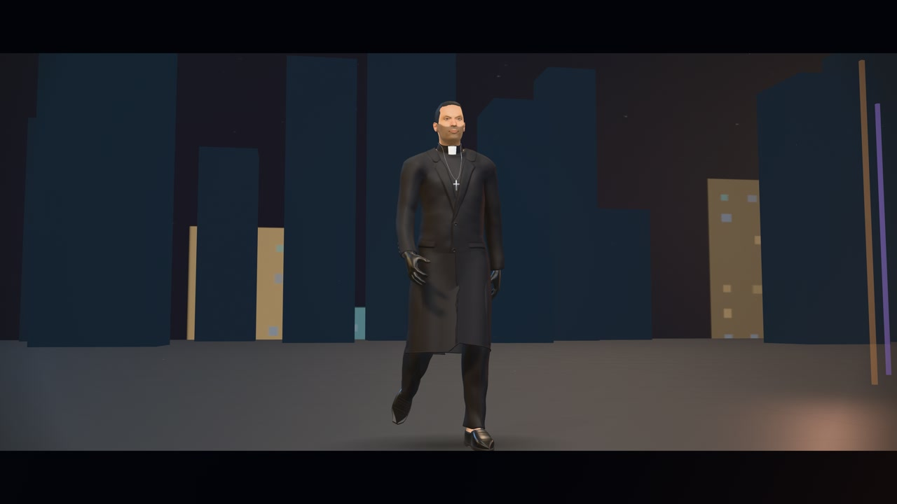
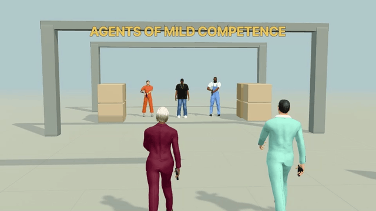

# Ara 3D Gen

**Open-source, self-hosted generator for realistic 3D human characters: rigged, animated and ready for your engine.**

*Ara* is Yoruba for "body". Easy to run, free to use, no limits.

**▶ Try it online: [ara3dgen.com](https://ara3dgen.com)**, or self-host it (below).

Shape a body, dress it, give it hair, a beard, tattoos and a weapon, pick from 161 animations, and export **GLB, FBX, OBJ or a ZIP bundle**. It runs entirely on your machine, in the browser or headless from the command line, with no accounts, credits or limits.



<p align="center"></p>

<p align="center"><a href="https://ara3dgen.com/media/ARA_3D_GEN_Cinematic_Cut_v9_4K.mp4"></a><br><sub>▶ <a href="https://ara3dgen.com/media/ARA_3D_GEN_Cinematic_Cut_v9_4K.mp4">Watch the cinematic (0:30)</a></sub></p>


<p align="center"><a href="https://ara3dgen.com/studio/"></a><br><sub><strong>Made in Ara Studio:</strong> Agents of Mild Competence: The Warehouse · full 30-second preview, without audio · <a href="https://ara3dgen.com/studio/">Try Studio</a></sub></p>


## Why self-hosted?

Online character generators are convenient, but you rent them. Ara 3D Gen is yours:

| | Online platforms | Ara 3D Gen |
| --- | --- | --- |
| Cost | Subscriptions, credits or per-export fees | Free, MIT-licensed |
| Limits | Monthly export or generation caps | Unlimited, as many characters as your machine can make |
| Privacy | Your projects live on someone's server | Nothing leaves your computer |
| Offline | Needs an internet connection | Works offline once set up |
| Automation | Usually a web UI only, sometimes a paid API | Scriptable CLI and a TypeScript API: generate hundreds of NPCs in a loop |
| Ownership | Licence terms can change or restrict use | CC0 base assets and free motion capture: use exports commercially, no attribution |
| Customisation | What the vendor ships | Fork it: add garments, hairstyles, animations, presets, export rules |
| Longevity | The service can shut down or change pricing | The code and your pipeline stay with you |

## Features

- **Realistic humans:** built on the CC0 MakeHuman dataset: 900+ morph targets, 219 detail sliders, 20 photo-based skins across age, ethnicity and sex, three detail levels (≈5k to 120k triangles).
- **Quick build:** a guided mode where you tap options (body, heritage, 30 outfit styles, colours, hair, extras, vehicles and an action) and watch the character update. Pick a vehicle to preview its matching animation, then choose its colour, style and finish. Plain-words summary, undo, *Surprise me*, and every unavailable option explains why. *Detailed* has every slider.
- **30 presets:** including the Female Executive, Miami Dealer, Gangster, Priest, Corporate High-Flier, Prison Escapee, Arabian Oil Tycoon and Adventurer. Plus one-click, reproducible random characters.
- **Clothing:** MakeHuman outfits, or mix-and-match tops, bottoms, wrappers, uniforms and 30+ accessories. Generated fabrics (kente, aso-oke, ankara, adire, camo, leather…), all recolourable.
- **Hair and looks:** MakeHuman hairstyles plus buzz cut, punk mohawk, cornrows and box braids. Stubble, mustache, goatee and beards. Tattoos. Earrings.
- **Faces that come alive:** blinking and glances, 9 expressions with teeth and tongue, a talking clip and lip-sync mouth shapes, exported as blend shapes.
- **Auto-rigging:** game rig (Mixamo bone names; Unity Humanoid / Unreal / Mixamo compatible), lite or full skeleton, A- or T-pose, optional face bones, a `WeaponR` socket.
- **161 animations:** a motion-captured walk, model walk (catwalk) and run, turns, jumps, pickup, press, open door, push, carry idle/walk, sitting and lying, forward roll and side dodges, combat, emotes, a full shooter set, melee and vehicles, with optional root motion. What you see in the preview is what you export.
- **Props:** a rifle, pistol, sword, knife and grenade (exported in the hand or as separate props), bags, a parcel and an animated parachute, plus fourteen customizable vehicle props fitted to eighteen riding/driving actions: bicycle, classic convertible, modern sports car and SUV (driver/passenger), motorcycle, horse, canoe, kayak, rowing boat, motorboat, helicopter, pickup, military tank and jet, plus jet taxi, take-off, landing and parachute bail-out, a helicopter parachute jump, a tank machine gunner and crash-and-roll-out escapes. Use them in the builder and Studio, and export them separately in GLB, FBX or OBJ. Riding actions can travel through Studio sets with adjustable speed. Riders can wield guns or blades; Studio adds per-action left/right and up/down aiming, firing and weapon visibility. Each vehicle has boarding/alighting actions (including both car seats), with hinged car doors, shared passenger seats in Studio, waiting vehicles and parked props retained across transfers. Save/Open character settings let you reuse custom cast members.
- **Exports you can trust:** an export panel that lists every file before you download it: static, rigged, or rigged + animations; one file or one per clip; Unity `model@clip` and Godot loop naming.
- **Share:** a branded image of your character, a caption and a link that rebuilds the exact character in the app (no server or account needed).
- **Ara Studio (early preview):** open your character in `/studio/`, search 66 categorized sets with expanded outdoor locations, direct up to five preset or saved custom characters with 161 animations, orbit the scene, add subtitles or comic bubbles that follow characters, and add typed, recorded or uploaded speech with voice effects, timed sound effects and nine recorded music options. Export a 720p or 1080p MP4 with sound. [Studio guide](docs/studio.md).
- **LLM Assist:** copy a complete guide from the character builder or Studio into your preferred AI assistant, then paste or open its JSON to build a character or an editable film with a custom-designed cast. Studio includes downloadable staging maps for all 66 sets: water boundaries, paths, seats, obstacles, reference routes and a harbour boarding pier. **Check staging** reviews complete paths and exports fitted transition coordinates. Studio supports character specifications directly and prepares scripted voices during review. No API key needed.
- **Tested:** `npm test` builds 387 characters and validates every format; `npm run test:gltf` checks every bone of every clip in three.js; `npm run test:ui` drives the app in headless Chrome.

## Quick start

Works on **Windows, macOS and Linux**. Requirements: **Node 20+** and **git**.

```bash
git clone https://github.com/olatunde85/3d-gen.git
cd 3d-gen
npm install
npm run setup-assets   # one-time: downloads CC0 MakeHuman data (~420 MB) and builds public/assets (~85 MB)
npm run dev            # open http://localhost:5173 (landing page; the app is at /app/)
```

**Already cloned it?** Update with `git pull`, `npm install`, then `npm run setup-assets` (about a minute; it reuses your downloads). Building, deploying and the command line are covered in [Self-hosting](docs/self-hosting.md).

## Documentation

The full guides live in [`docs/`](docs/README.md), also at [ara3dgen.com/docs](https://ara3dgen.com/docs/):

- [Self-hosting](docs/self-hosting.md): install, update, build, deploy, command line, tests
- [Using characters in your engine](docs/engines.md): Unity, Unreal, Godot, Blender and the web
- [Bodies, clothing and looks](docs/characters.md) · [Faces, expressions and lip-sync](docs/faces.md) · [Animations](docs/animations.md)
- [Rigging](docs/rigging.md) · [Exporting](docs/exporting.md) · [Architecture](docs/architecture.md)
- [Ara Studio](docs/studio.md): short films with up to five characters, dialogue, sound and music

Questions and showcases: [Discussions](https://github.com/olatunde85/3d-gen/discussions). Bugs and ideas: [Issues](https://github.com/olatunde85/3d-gen/issues). What changed in each version: [Releases](https://github.com/olatunde85/3d-gen/releases).

## Licensing

- **Code:** [MIT](LICENSE).
- **Studio music:** nine recorded tracks supplied for Ara, compressed and loudness-matched with FFmpeg. Creator/source credits ship in `media/music/CREDITS.txt`; music retains its own rights and is not covered by the code licence.
- **Studio speech tools:** optional local Supertonic 2 voices use separately downloaded OpenRAIL-M model files; ONNX Runtime Web is MIT. Native device voices are available for read-throughs. Notices ship in `third-party/speech/`; see the [Studio guide](docs/studio.md#assets-and-licences).
- **Studio video tools:** Mediabunny is MPL 2.0. Static builds include its licence and original source in `third-party/mediabunny/`; see the [Studio guide](docs/studio.md#assets-and-licences).
- **Character data:** MakeHuman assets, CC0 1.0 (public domain); see [scripts/ASSETS_LICENSE.txt](scripts/ASSETS_LICENSE.txt). They are downloaded by `setup-assets`, not stored in this repository.
- **Motion capture:** the captured clips come from the [CMU Graphics Lab Motion Capture Database](http://mocap.cs.cmu.edu): free to use, including in commercial products, but the data may not be resold on its own. The data used in this project was obtained from mocap.cs.cmu.edu. The database was created with funding from NSF EIA-0196217. The retargeted clips are baked into `src/core/anim/clips/mocap-data.ts` by `npm run build-mocap` (takes are listed in `scripts/mocap-takes.ts`).
- **Your exports:** yours. Use them in commercial and non-commercial projects without attribution.

## Contributing

Garments, hairstyles, animations, presets, engine notes, docs and bug reports are all welcome: see [CONTRIBUTING.md](CONTRIBUTING.md).

## Roadmap

See the open [issues](https://github.com/olatunde85/3d-gen/issues), for example more animations (head-load carrying, swimming, climbing) in [#1](https://github.com/olatunde85/3d-gen/issues/1) and face capture with Apple's 52 ARKit shapes in [#11](https://github.com/olatunde85/3d-gen/issues/11).
