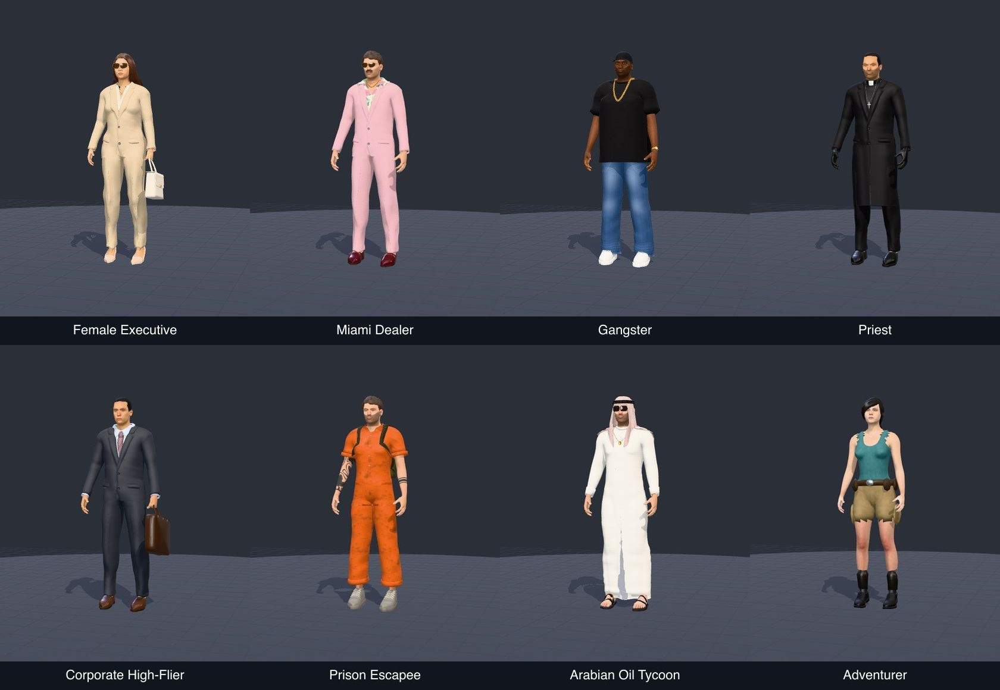
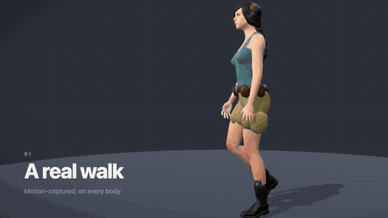
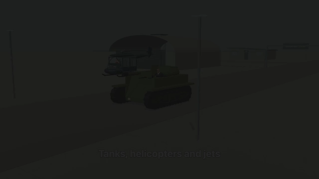
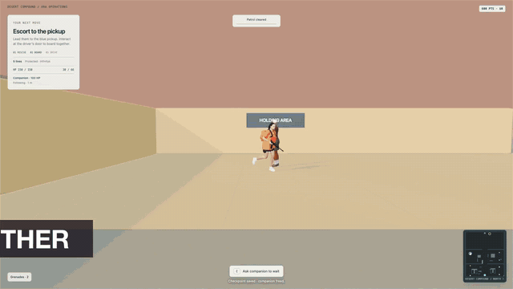

<p align="center">
  <a href="https://ara3dgen.com"><picture>
    <source media="(prefers-color-scheme: dark)" srcset="public/logo.svg">
    
  </picture></a>
</p>

<h1 align="center">Ara 3D Gen</h1>

<p align="center">
  <strong>Build it. Film it. Play it.</strong><br>
  Realistic 3D characters, short films and games, free in your browser and open source.
</p>

<p align="center">
  <a href="https://ara3dgen.com"></a>
  <a href="https://www.npmjs.com/package/ara3d"></a>
  <a href="LICENSE"></a>
  
</p>

<p align="center">
  <a href="https://ara3dgen.com/app/">Builder</a> ·
  <a href="https://ara3dgen.com/studio/">Studio</a> ·
  <a href="https://ara3dgen.com/play/">Play</a> ·
  <a href="https://ara3dgen.com/characters/">Characters</a> ·
  <a href="https://ara3dgen.com/docs/">Docs</a> ·
  <a href="https://github.com/olatunde85/3d-gen/discussions">Discussions</a>
</p>



*Ara* is Yoruba for "body". No accounts, credits or limits, and what you export is yours.

## Three apps, one cast

### The character builder

Shape a body, dress it, give it hair, tattoos and a weapon, pick from **259 animations** and export **GLB, FBX, OBJ or a ZIP bundle** for Unity, Unreal, Godot, Blender or the web. Start from 65 ready-made characters, or open your own.

<p align="center"></p>

### Ara 3D Studio

Direct films of up to five scenes with up to five characters on **71 sets**, or on sets you build in Blender. Add dialogue with natural voices, subtitles, caption bands and title cards, sound effects and music, then export an MP4.

<p align="center"><a href="https://ara3dgen.com/studio/"></a><br><sub>Every shot made and exported in Studio · <a href="https://ara3dgen.com/media/ara-studio-reel.mp4">Watch with sound</a></sub></p>

### Ara Play

Build games from missions, arcade races and endless runs, string them into a campaign of up to ten chapters, and publish it online in about a minute. No code, no engine, no install.

<p align="center"><a href="https://ara3dgen.com/play/"></a><br><sub>Dead Drop, a ten-chapter game made in Ara Play · <a href="https://ara3dgen.com/media/ara-play-promo.mp4">Watch with sound</a></sub></p>

## Made anywhere, at home in Ara

| | What you bring | Guide |
| --- | --- | --- |
| **Your characters** | A rigged character from Mixamo, Ready Player Me, VRoid or Blender (FBX, GLB, VRM). Every Ara animation plays on it, and it exports with them baked in. | [Your own characters](docs/import-characters.md) |
| **Your animations** | Mixamo downloads, Blender actions, motion capture or a still pose (FBX, GLB, glTF, BVH), fitted to every character as a content pack. | [Content packs](docs/packs.md) |
| **Your sets** | A place modelled and lit in Blender, exported with the free *Export for Ara Studio* add-on and imported into Studio in one click. | [Your own sets](docs/studio-sets.md) |
| **Your AI and voices** | Your own Gemini, Claude, OpenAI, OpenRouter or ElevenLabs key. **Ask Ara** writes, builds, voices and scores, and keys never leave your browser. | [Your own AI and voices](docs/keys.md) |

No key? **Assist** gives you a guide to paste into any AI chat, and builds what it writes back.

## For developers

**Characters from the command line.** No clone needed, with Node 20+:

```bash
npx ara3d export --preset "The Soldier"            # GLB in ./ara3d-out
npx ara3d export --random 1-50 --formats glb,fbx  # 50 different characters
```

**In your three.js app or game:**

```js
import { createCharacter } from 'ara3d';
const hero = await createCharacter('The Soldier', { animations: ['walk', 'idle'] });
scene.add(hero.scene);
```

**On any web page,** with one tag:

```html
<script type="module" src="https://cdn.jsdelivr.net/npm/ara3d@0/dist/embed.js"></script>
<ara-character preset="The Soldier" animation="rifle_idle" weapon="rifle"></ara-character>
```

**In your AI assistant:** `claude mcp add ara3d -- npx -y ara3d mcp` lets Claude, Cursor, VS Code and others make characters for you.

Guides: [Command line](docs/cli.md) · [JavaScript library](docs/library.md) · [Embed](docs/embed.md) · [AI assistants (MCP)](docs/mcp.md) · [Using characters in your engine](docs/engines.md)

## Why own it?

Online character generators are convenient, but you rent them. Ara 3D Gen is yours:

| | Online platforms | Ara 3D Gen |
| --- | --- | --- |
| Cost | Subscriptions, credits or per-export fees | Free, MIT-licensed |
| Limits | Monthly export or generation caps | Unlimited |
| Privacy | Your projects live on someone's server | Self-hosted, nothing leaves your computer |
| Automation | Usually a web UI only, sometimes a paid API | A scriptable CLI, a TypeScript library and an MCP server |
| Ownership | Licence terms can change or restrict use | CC0 base assets and free motion capture: use exports commercially, no attribution |
| Customisation | What the vendor ships | Fork it: add garments, hairstyles, animations, presets, export rules |
| Longevity | The service can shut down or change pricing | The code and your pipeline stay with you |

## Features in detail

<details>
<summary><strong>Characters</strong></summary>

- **Realistic humans:** built on the CC0 MakeHuman dataset: 900+ morph targets, 219 detail sliders, 20 photo-based skins across age, ethnicity and sex, and three detail levels (about 5k to 120k triangles).
- **Quick build:** tap options (body, heritage, 44 outfit styles, colours, hair, extras, vehicles and an action) and watch the character update, with undo and *Surprise me*. *Detailed* has every slider.
- **65 presets:** the Chef, Footballer, Doctor, Airline Pilot, Getaway Driver, Female Executive, Yoruba Warrior and more, on the [characters page](https://ara3dgen.com/characters/) with search, filters and a one-click .glb download, plus reproducible random characters.
- **Clothing:** MakeHuman outfits, or mix-and-match tops, bottoms, uniforms and 30+ accessories in recolourable fabrics, from denim, linen and leather to camo and printed patterns.
- **Hair and looks:** MakeHuman hairstyles plus buzz cut, punk mohawk, cornrows and box braids; stubble, mustaches and beards; tattoos and earrings.
- **Faces that come alive:** blinking and glances, 9 expressions with teeth and tongue, a talking clip and lip-sync mouth shapes, exported as blend shapes.
- **Auto-rigging:** a game rig with Mixamo bone names (Unity Humanoid, Unreal and Mixamo compatible), lite or full skeleton, A- or T-pose, optional face bones and a `WeaponR` socket.
- **Props and vehicles:** rifles, pistols, a sword, knife and grenade, bags, a phone, a parachute and climbing props; fourteen vehicles fitted to the rider, from a bicycle and a horse to a helicopter, a tank and a jet, each with boarding and alighting.
- **Exports you can trust:** the export panel lists every file before you download: static, rigged, or rigged with animations; one file or one per clip; Unity `model@clip` and Godot loop naming.
- **Share:** an image of your character and a link that rebuilds it exactly, with no server or account.

</details>

<details>
<summary><strong>259 animations</strong></summary>

Motion-captured walks, a catwalk, runs and turns; jumps; unarmed and sword fighting; football (shots, passes, slide tackles, goalkeeping, throw-ins and the Siu celebration); gunshot reactions; a shooter set with cover, rifle hits and deaths; reactions and get-ups; picking up, pressing, opening doors, pushing and carrying (in the hands or on the head); everyday actions (talking, phone calls, texting, leaning, sweeping); emotes and dances; sitting and lying; swimming and diving; ladders, vaults and ledges; rolls and dodges; parachuting; and riding all fourteen vehicles. Optional root motion, and what you see in the preview is what you export. [Animations](docs/animations.md).

</details>

<details>
<summary><strong>Ara 3D Studio</strong></summary>

- **Films:** up to five scenes, each up to a minute, with up to five Ara or imported characters on 71 searchable sets or your own.
- **Directing:** shots and camera moves, characters that walk, drive and sit through the set, and staging checks for paths and seats.
- **Words on screen:** subtitles (and SRT import and export), outlined text, caption bands, title cards, and speech and thought bubbles that follow a character.
- **Sound:** typed, recorded or uploaded dialogue with natural voices (your Gemini or ElevenLabs voices, or free local voices), voice effects, timed sound effects and music.
- **Export:** a 720p or 1080p MP4 with sound. [Studio guide](docs/studio.md).

</details>

<details>
<summary><strong>Ara Play</strong></summary>

- **Missions:** escape, rescue and clear across five locations: reach, download, defend, eliminate, survive, escort, chase and convoy.
- **Companions and vehicles:** free a companion who follows you and rides along; 14 drivable vehicles.
- **Combat:** pistols, rifles and grenades, cover, stealth takedowns, snipers, heavies and squad leaders.
- **A city between chapters:** free roam with traffic, pedestrians, police and a wanted level, side jobs and a car radio.
- **Arcade races:** 11 circuits, 14 vehicles from a keke to a city bus, drifting, nitro, items, ghosts, cups and expert rivals.
- **Endless runs:** 11 settings and 7 power-ups, including spring boots and a hoverboard.
- **Campaigns and story:** up to ten chapters in any mix of modes, with branching choices, dialogue, voices and opening and ending films.
- **Publish online:** live in about a minute with no sign-up, or download the game and host it anywhere. [Play guide](docs/play.md) · [Hosting your game](docs/hosting-games.md).

</details>

## Run it yourself

Works on **Windows, macOS and Linux**, with **Node 20+** and **git**.

```bash
git clone --depth 1 https://github.com/olatunde85/3d-gen.git
cd 3d-gen
npm install
npm run setup-assets   # one-time: downloads CC0 MakeHuman data (~420 MB), builds public/assets (~50 MB) and fetches the site videos
npm run dev            # open http://localhost:5173 (landing page; the app is at /app/)
```

`--depth 1` downloads only the current files (about 50 MB) instead of the full history. To update, run `git pull`, `npm install`, then `npm run setup-assets` (about a minute; it reuses your downloads). Building, deploying and testing are covered in [Self-hosting](docs/self-hosting.md): `npm test` builds 515 characters and checks every export format.

## Documentation

The full guides live in [`docs/`](docs/README.md), also at [ara3dgen.com/docs](https://ara3dgen.com/docs/):

- [Self-hosting](docs/self-hosting.md) · [Using characters in your engine](docs/engines.md) · [Architecture](docs/architecture.md)
- [Bodies, clothing and looks](docs/characters.md) · [Faces and lip-sync](docs/faces.md) · [Animations](docs/animations.md) · [Rigging](docs/rigging.md) · [Exporting](docs/exporting.md)
- [Ara Studio](docs/studio.md) · [Ara Play](docs/play.md)
- [Your own characters](docs/import-characters.md) · [Content packs](docs/packs.md) · [Your own sets](docs/studio-sets.md) · [Your own AI and voices](docs/keys.md)

Questions and showcases: [Discussions](https://github.com/olatunde85/3d-gen/discussions). Bugs and ideas: [Issues](https://github.com/olatunde85/3d-gen/issues). What changed in each version: [Releases](https://github.com/olatunde85/3d-gen/releases).

## Licensing

- **Code:** [MIT](LICENSE).
- **Export for Ara Studio (the Blender add-on):** GPL-3.0, as Blender add-ons are; see [studio-sets/ara_set_export/LICENSE](studio-sets/ara_set_export/LICENSE). The set files you make with it are yours.
- **Character data:** MakeHuman assets, CC0 1.0 (public domain); see [scripts/ASSETS_LICENSE.txt](scripts/ASSETS_LICENSE.txt). They are downloaded by `setup-assets`, not stored in this repository.
- **Motion capture:** the captured clips come from the [CMU Graphics Lab Motion Capture Database](http://mocap.cs.cmu.edu): free to use, including in commercial products, but the data may not be resold on its own. The data used in this project was obtained from mocap.cs.cmu.edu. The database was created with funding from NSF EIA-0196217. The retargeted clips are baked into `src/core/anim/clips/mocap-data.ts` by `npm run build-mocap` (takes are listed in `scripts/mocap-takes.ts`).
- **Studio music:** nine recorded tracks supplied for Ara, compressed and loudness-matched with FFmpeg. Credits ship in `media/music/CREDITS.txt`; the music keeps its own rights and is not covered by the code licence.
- **Studio speech tools:** optional local Supertonic 2 voices use separately downloaded OpenRAIL-M model files; ONNX Runtime Web is MIT. Notices ship in `third-party/speech/`; see the [Studio guide](docs/studio.md#assets-and-licences).
- **Studio video tools:** Mediabunny is MPL 2.0. Static builds include its licence and original source in `third-party/mediabunny/`.
- **Platform logos on the site:** from [Simple Icons](https://simpleicons.org) (CC0); the trademarks belong to their owners.
- **Your exports:** yours. Use them in commercial and non-commercial projects without attribution.

## Contributing

Garments, hairstyles, animations, presets, sets, engine notes, docs and bug reports are all welcome: see [CONTRIBUTING.md](CONTRIBUTING.md). Ideas in progress are in the open [issues](https://github.com/olatunde85/3d-gen/issues), such as more cultural dances ([#1](https://github.com/olatunde85/3d-gen/issues/1)) and face capture with Apple's 52 ARKit shapes ([#11](https://github.com/olatunde85/3d-gen/issues/11)).
