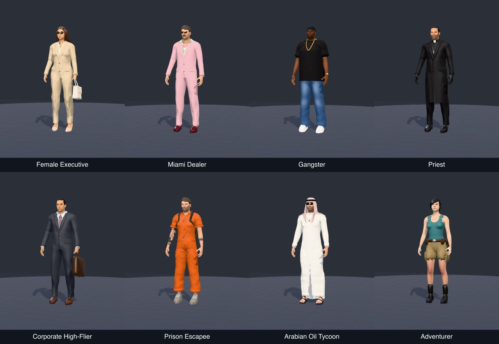
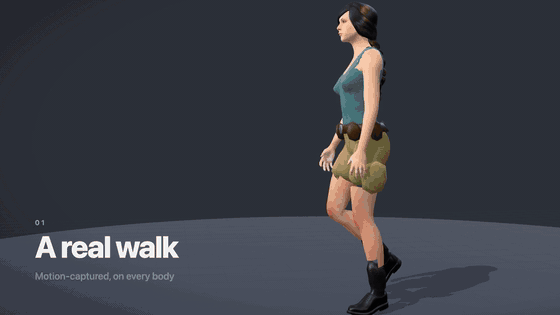
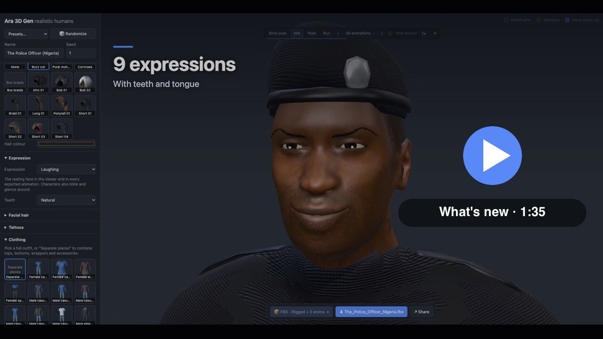

# Ara 3D Gen

**Open-source, self-hosted generator for realistic 3D human characters: rigged, animated and ready for your engine.**

*Ara* is Yoruba for "body". Easy to run, free to use, no limits.

**▶ Try it online: [ara3dgen.com](https://ara3dgen.com)**, or self-host it (below).

Shape a body, dress it, give it hair, a beard, tattoos and a weapon, pick from 70 animations, and export **GLB, FBX, OBJ or a ZIP bundle**. It runs entirely on your machine, in the browser or headless from the command line, with no accounts, credits or limits.



<p align="center"></p>

<p align="center"><a href="https://ara3dgen.com/media/ara-3d-gen-whats-new.mp4"></a><br><sub>▶ <a href="https://ara3dgen.com/media/ara-3d-gen-whats-new.mp4">What's new (0:31)</a>: a motion-captured walk and run, faces that blink, react and talk, 70 animations and a bicycle. · <a href="https://ara3dgen.com/media/ara-3d-gen-demo.mp4">Full demo (1:45)</a></sub></p>


## Why self-hosted?

Online character generators are convenient, but you rent them. Ara 3D Gen is yours:

| | Online platforms | Ara 3D Gen |
| --- | --- | --- |
| Cost | Subscriptions, credits or per-export fees | Free, MIT-licensed |
| Limits | Monthly export or generation caps | Unlimited, as many characters as your machine can make |
| Privacy | Your projects live on someone's server | Nothing leaves your computer |
| Offline | Needs an internet connection | Works offline once set up |
| Automation | Usually a web UI only, sometimes a paid API | Scriptable CLI and a TypeScript API: generate hundreds of NPCs in a loop |
| Ownership | Licence terms can change or restrict use | CC0 base assets and free motion capture: use exports commercially, no attribution |
| Customisation | What the vendor ships | Fork it: add garments, hairstyles, animations, presets, export rules |
| Longevity | The service can shut down or change pricing | The code and your pipeline stay with you |

## Features

- **Realistic humans:** built on the CC0 MakeHuman dataset: 900+ morph targets, 219 detail sliders, 20 photo-based skins across age, ethnicity and sex, three detail levels (≈5k to 120k triangles).
- **19 presets:** athletes, a detective, a secret agent, a soldier, a cyberpunk hacker, a wasteland survivor, African warriors (Yoruba, Maasai, Zulu, Dahomey), and Nigerian Police and FRSC officers. Plus one-click, reproducible random characters.
- **Clothing:** MakeHuman outfits, or mix-and-match tops, bottoms, wrappers, uniforms and 30+ accessories. Generated fabrics (kente, aso-oke, ankara, adire, camo, leather…), all recolourable.
- **Hair and looks:** MakeHuman hairstyles plus buzz cut, punk mohawk, cornrows and box braids. Stubble, mustache, goatee and beards. Tattoos. Earrings.
- **Faces that come alive:** blinking and glances, 9 expressions with teeth and tongue, a talking clip and lip-sync mouth shapes, exported as blend shapes.
- **Auto-rigging:** game rig (Mixamo bone names; Unity Humanoid / Unreal / Mixamo compatible), lite or full skeleton, A- or T-pose, optional face bones, a `WeaponR` socket.
- **70 animations:** a motion-captured walk and run, turns, jumps, sitting and lying, combat, emotes, a full shooter set, melee and vehicles, with optional root motion. What you see in the preview is what you export.
- **Props:** a rifle, pistol, sword and knife on the socket (exported in the hand or as separate props), and a bicycle fitted to every rider.
- **Exports you can trust:** an export panel that lists every file before you download it: static, rigged, or rigged + animations; one file or one per clip; Unity `model@clip` and Godot loop naming.
- **Share:** a branded image of your character, a caption and a link that rebuilds the exact character in the app (no server or account needed).
- **Tested:** `npm test` builds 259 characters and validates every format; `npm run test:gltf` checks every bone of every clip in three.js; `npm run test:ui` drives the app in headless Chrome.

## Quick start

Works on **Windows, macOS and Linux**. Requirements: **Node 20+** and **git**.

```bash
git clone https://github.com/olatunde85/3d-gen.git
cd 3d-gen
npm install
npm run setup-assets   # one-time: downloads CC0 MakeHuman data (~420 MB) and builds public/assets (~85 MB)
npm run dev            # open http://localhost:5173 (landing page; the app is at /app/)
```

**Already cloned it?** Update with `git pull`, `npm install`, then `npm run setup-assets` (about a minute; it reuses your downloads). Building, deploying and the command line are covered in [Self-hosting](docs/self-hosting.md).

## Documentation

The full guides live in [`docs/`](docs/README.md), also at [ara3dgen.com/docs](https://ara3dgen.com/docs/):

- [Self-hosting](docs/self-hosting.md): install, update, build, deploy, command line, tests
- [Using characters in your engine](docs/engines.md): Unity, Unreal, Godot, Blender and the web
- [Bodies, clothing and looks](docs/characters.md) · [Faces, expressions and lip-sync](docs/faces.md) · [Animations](docs/animations.md)
- [Rigging](docs/rigging.md) · [Exporting](docs/exporting.md) · [Architecture](docs/architecture.md)

Questions and showcases: [Discussions](https://github.com/olatunde85/3d-gen/discussions). Bugs and ideas: [Issues](https://github.com/olatunde85/3d-gen/issues). What changed in each version: [Releases](https://github.com/olatunde85/3d-gen/releases).

## Licensing

- **Code:** [MIT](LICENSE).
- **Character data:** MakeHuman assets, CC0 1.0 (public domain); see [scripts/ASSETS_LICENSE.txt](scripts/ASSETS_LICENSE.txt). They are downloaded by `setup-assets`, not stored in this repository.
- **Motion capture:** the captured clips come from the [CMU Graphics Lab Motion Capture Database](http://mocap.cs.cmu.edu): free to use, including in commercial products, but the data may not be resold on its own. The data used in this project was obtained from mocap.cs.cmu.edu. The database was created with funding from NSF EIA-0196217. The retargeted clips are baked into `src/core/anim/clips/mocap-data.ts` by `npm run build-mocap` (takes are listed in `scripts/mocap-takes.ts`).
- **Your exports:** yours. Use them in commercial and non-commercial projects without attribution.

## Contributing

Garments, hairstyles, animations, presets, engine notes, docs and bug reports are all welcome: see [CONTRIBUTING.md](CONTRIBUTING.md).

## Roadmap

See the open [issues](https://github.com/olatunde85/3d-gen/issues), for example more animations (interaction, dodge and roll, carrying) in [#1](https://github.com/olatunde85/3d-gen/issues/1) and face capture with Apple's 52 ARKit shapes in [#11](https://github.com/olatunde85/3d-gen/issues/11).
